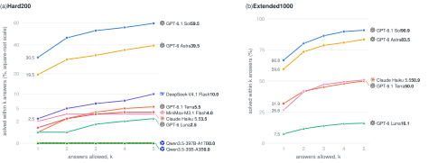
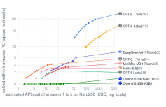
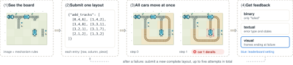
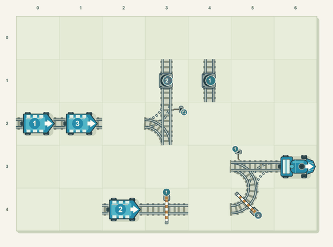
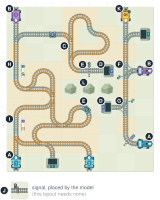
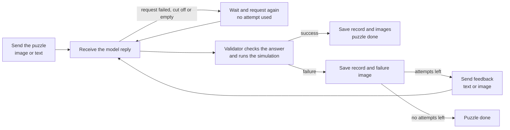

# Railbound-Bench

**English** | [中文](README_zh.md)

Railbound-Bench is a benchmark for spatiotemporal planning and plan repair in multimodal large language models, inspired by the puzzle game [Railbound](https://afterburn.games/railbound/). Based on the 233 official Railbound puzzles, we built 200 hard puzzles and 1,000 extended puzzles of varying difficulty whose distribution resembles the official levels. Every puzzle comes with its question and reference answer, each as JSON and as an image. We also provide a validator (a program that checks answers), a layout solver (a rule-based puzzle solver), the evaluation program and several helper programs. Models answer directly from the text and images, without tools, agents or code execution.

Railbound-Bench 是一个评测多模态大模型时空规划与计划修复能力的 benchmark，受到 [Railbound](https://afterburn.games/railbound/) 游戏的启发。本 benchmark 参考了 Railbound 官方的 233 个谜题，制作了 200 个高难度谜题和 1000 个难度各异、与官方关卡分布相似的扩展谜题。每个谜题都有题目的文字和图像形式、参考解答的文字和图像形式。此外，我们还提供验证器（检查答案的程序）、布局求解器（基于规则的谜题求解器）、评测程序及部分辅助程序。模型直接从文本/图像中推断，而无需工具、代理或代码执行。

Paper: [*Seeing Is Not Planning: Spatiotemporal Planning and Plan Repair in Multimodal LLMs*](https://www.researchgate.net/publication/418163282_Seeing_Is_Not_Planning_Spatiotemporal_Planning_and_Plan_Repair_in_Multimodal_LLMs)

---

## Main Results

The leaderboard below covers nine models. The vertical axis is the share of puzzles solved within k answers (S@k): after a wrong answer, the model sees an image of how its previous attempt failed and submits a new complete answer, up to five answers in total. Hard200 is the main leaderboard; Extended1000 has more puzzles and a wider range of difficulty.

<p align="center"></p>

The next figure plots, for Hard200, each model's estimated API cost of its first k answers against S@k. Costs apply each provider's official list price to the recorded tokens. Labels give the total cost at k=5.

<p align="center"></p>

## About the Benchmark

### Task

Each puzzle is a grid board with fixed rails, cars, engines and various mechanisms. The model adds track pieces (straight, curved or three-way) to empty cells, within the puzzle's track budget; some puzzles also allow signals. The model returns all additions at once, and the simulator then starts all cars together and checks whether the layout delivers every car to its engine in order. After a failure, the model receives feedback and submits a new complete layout, up to five times (the number can be changed with `--rounds` when evaluating).

<p align="center"></p>

### Game rules

The board runs in steps: at every step, all cars move one cell at the same time, unless a gate, a signal or a station holds them. Each car must reach an engine of its own type, cars of the same type must arrive in ascending number order, and a delivered car leaves the board. Any of the following is a failure:

- two cars enter the same cell, or swap neighbouring cells head-on (collision);
- a car runs onto a missing or mismatched rail, or off the board (derailment);
- cars arrive in the wrong order or at the wrong engine, or a car skips a stop it must make;
- the board returns to an earlier state, which would repeat forever.

The puzzle succeeds when every required car has reached its engine in order. Because all cars share the same rails and mechanisms, a piece that routes one car correctly can block, delay or redirect another, so a layout can only be judged as a whole.

The animation below runs the simple extended puzzle E-CT0022 with its reference answer. The first frame is the puzzle itself; the cars then advance step by step, and the orange rails are the ones the reference answer adds. The three cars share the junctions and gates in the middle, so they must take turns to reach the engine in the order 1, 2, 3.

<p align="center"></p>

The figure shows extended puzzle E-TR1501 with its reference layout. Grey rails are given; orange rails are the 30 pieces added by the reference answer. Letters mark one example of each element. Numbers printed on the board belong to the game: a shared number links objects that work together, such as a car and its station, or a button and the gates it controls.

<p align="center"></p>

| | Element | Rule |
| --- | --- | --- |
| A | Car and engine | Every car moves one cell per step in the direction it faces, reaches the engine in number order, and leaves the board once delivered |
| B | Freight car | Freight cars (Roman numerals) go to the freight engine, in their own number order |
| C | Three-way rail | A car entering at either end of the curve follows the curve; a car entering at the third end goes straight |
| D | Tunnel | Two portals with the same number are linked; a car entering one leaves the other in the same step |
| E | Button and gate | A car crossing a button opens or closes every gate with the same number; cars wait at a closed gate |
| F | Button-switched points | The curve of this three-way rail flips when a car crosses the button with the same number |
| G | Self-switching points | The curve of this three-way rail flips each time a car enters it |
| H | Passenger station | The car with the matching number must stop here for two extra steps before it is delivered; other cars pass by |
| I | Post office | Works like a station, for the freight car with the matching numeral |
| J | Signal | Placed by the model next to a three-way rail. It holds cars until another car leaves that rail moving away from the signal, then stays open |
| K | Decoy car | Need not be delivered and may not enter an engine. It can press buttons; if it derails, its wreck blocks the track |
| L | Rock or building | Blocks travel; no track can be placed on it |

### Puzzle sets

| Set | Location | Puzzles | Notes |
| --- | --- | --- | --- |
| Hard200 | `levels/extended-hard/` | 200 | Main leaderboard; all puzzles are hard |
| Extended1000 | `levels/extended/` | 1,000 | Split into easy / medium / hard |
| Controlled180 | `levels/subsets/controlled180.json` | 180 | Fixed puzzles selected from Extended1000 for the controlled studies in the paper |

Each puzzle's reference answer is at the same relative path under `solutions/`; puzzle and reference images sit next to their JSON files. Controlled180 is only a list of puzzle IDs; the puzzles themselves stay in `levels/extended/`.

## How to Use

### 1. Installation and model configuration

#### 1.1. Install

Python 3.9 or newer is required. Clone the project and install the dependencies:

```bash
git clone https://github.com/liaoyanqing666/Railbound_Bench.git
cd Railbound_Bench
python -m pip install -r requirements.txt
```

There are only three dependencies: `Pillow` (drawing), `httpx` (model API requests) and `python-dotenv` (reading `.env`). The solver can optionally use `g++` or `clang++` for speed; without a compiler it falls back to Python.

#### 1.2. Configure a model

1. Edit a configuration file under `configs/`: fill in the API address (`base_url`), the name of the key variable (`api_key_env`), the model (`api_model`) and its limits (`model_limits`).
2. Create a `.env` file in the project root and set the API key variable, for example `DEEPSEEK_API=sk-...`. Git ignores `.env`.
3. `benchmark.py` reads the configuration at startup. It decides which platform and model to call, which environment variable holds the key, how many tokens each generation may use, and so on. The full configuration is saved to `run.json` in the result directory, and a resumed run checks that it has not changed. One configuration file can therefore be reused, and every result can be traced to an exact model and setting.

The examples below are some of the models used in the paper. You can edit them yourself, or use AI agents to support more models, platforms or situations. Any platform with an OpenAI Chat Completions endpoint can start from the `openai_compatible.json` template.

| Example configuration | Authentication and use |
| --- | --- |
| `openai_compatible.json` | Template for any Chat Completions endpoint: set the address, key variable, model and the limits from the official documentation |
| `deepseek.json` | Reads `DEEPSEEK_API`; DeepSeek API |
| `aliyun_qwen35_35b_a3b.json` | Reads `ALIYUN_API`; Qwen3.5-35B-A3B through the OpenAI-compatible endpoint of Alibaba Cloud Model Studio |
| `claude_haiku_api.json` | Reads `CLAUDE_API`; Claude Haiku 5.5 through the native Anthropic Messages API |

You can even test GPT models without an API key: a ChatGPT account can sign in through OAuth (the way Codex does) to obtain an access token, and that token can call OpenAI's Responses endpoint directly, with usage counted against the account's subscription. If you need this, adapt it yourself following OpenAI's official documentation.

Note: with the Anthropic API, a configuration can set `max_text_continuations`. When a generation stops at the output limit, the program sends the generated content back and the model finishes the same answer in a new generation, instead of the answer being discarded. The example configuration sets it to 2; other platforms do not accept this field.

### 2. Evaluation

To evaluate a model, run:

```bash
python benchmark.py --config configs/deepseek.json
```

| Option | Required | Default | Meaning |
| --- | --- | --- | --- |
| `--config` | Yes | `configs/deepseek.json` | Model configuration file |
| `--levels` | No | `levels/extended-hard` | Puzzle directory or a single puzzle file. The default is the main leaderboard, Hard200; the extended set is `levels/extended` |
| `--level-id` | No | All | Evaluate only the given puzzle; repeat to select several, e.g. `--level-id EH-0001 --level-id EH-0002` |
| `--limit` | No | No limit | Evaluate only the first puzzles in sorted order |
| `--rounds` | No | 5 | Maximum answers per puzzle, including the first |
| `--prompt-mode` | No | `image_rules` | Form of the first input:<br>`image_rules`: the board image, plus the goal, what the drawings mean, the output format, and the rules and timing of this puzzle's mechanisms;<br>`image_no_rules`: the same image, goal, drawing guide and output format, without explaining how mechanisms change or how long cars wait;<br>`text_rules`: no image; instead a text rail grid, lists of mechanisms and cars, a table of allowed moves, and this puzzle's rules |
| `--feedback` | No | Follows the input form | Feedback after a wrong answer:<br>`binary`: only says the answer failed;<br>`textual`: describes in text the error type and the rails, mechanisms and cars at the selected moments;<br>`visual`: sends the same moments as images.<br>Image inputs default to `visual`; text input defaults to `textual` |
| `--history-steps` | No | 1 | Number of moments included in feedback; 0 means all |
| `--history-gap` | No | 1 | Steps between consecutive moments in feedback |
| `--workers` | No | 16 | Puzzles evaluated at the same time, which is also the maximum number of model requests in flight |
| `--output` | No | `output` | Directory for results |

<details>
<summary>Other engineering options</summary>

| Option | Required | Default | Meaning |
| --- | --- | --- | --- |
| `--max-retry` / `--max_retry` | No | 2 | Quick retries after a failed request, before delayed retries begin |
| `--retry-delay` | No | 60 | Seconds to wait before the first delayed retry |
| `--retry-max-delay` | No | 600 | Longest wait between delayed retries, in seconds; retries continue after reaching it |
| `--max-ticks` | No | 10000 | Maximum steps per simulation; usually left unchanged |
| `--resume` | No | None | Continue an existing result directory; the other options must match the original run |
| `--resolve-model` | No | Off | Only read the model's output limit and context length, without evaluating |

</details>

A few more points:

- Every answer must be the **complete** list of added tracks relative to the original puzzle, not an edit of the previous answer. The format is `{"add_tracks":[[row,column,piece], ...],"add_semaphores":[[row,column], ...]}`, with coordinates starting at 0; `add_semaphores` is needed only when the puzzle allows new signals.
- Only answers that are well formed enough to be judged use up an attempt. Network errors, timeouts, and replies that are cut off or empty are requested again in the same round and do not count as model mistakes.
- After an interruption, run again with the original configuration and options plus `--resume` to continue; finished puzzles are not requested again, e.g. `python benchmark.py --config configs/deepseek.json --resume output/RUN_DIRECTORY`.

**How a run proceeds**: each puzzle loops as follows until it is solved or out of attempts.



### 3. Viewing results

During evaluation, the terminal prints each puzzle's status as it finishes (`success` means solved; `exhausted` means all attempts failed). When the run is complete, show the scores with:

```bash
python benchmark.py --summarize output/RUN_DIRECTORY
```

The most useful fields are:

| Field | Meaning |
| --- | --- |
| `campaign_accuracy` | Overall accuracy, i.e. S@5 when `--rounds` is 5. It is `null` while some puzzles are unfinished |
| `success_by_round` | Puzzles first solved on answer k; summing answers 1 to k and dividing by the number of puzzles gives S@k |
| `error_types` | Error types over all wrong answers, such as `derailment`, `collision`, `wrong_order` and `illegal_edit` (changing given content) |
| `final_error_types` | Error type of the last answer for each unsolved puzzle |
| `request_error_types` | Network, timeout and other request errors; these do not count toward the model's score |

The result directory `output/MODEL_TIMESTAMP/` contains:

- `run.json`: model configuration, evaluation options, puzzle contents and a summary;
- `PUZZLE.json`: for each puzzle, the text of every answer, its judgment and error type;
- `images/`: a layout image for every answer (`-answer.png`) and, for wrong answers, a failure image (`-failure.png`) marking where cars collided or derailed.

After a validator update, `--rejudge-results output/RUN_DIRECTORY` judges the saved answers again under the new rules; `--render-results` only redraws the images. Neither contacts the model.

## Files

* `assets/`: images used in this README.

* `configs/`: model configuration files; each describes one model and its request settings.

* `levels/`: all puzzles. `extended-hard/` is Hard200, `extended/` is Extended1000 (in `easy/`, `medium/`, `hard/`), and `subsets/controlled180.json` lists the 180 fixed extended puzzles used for the controlled studies in the paper. Each set has a `manifest.json` listing its puzzles, and each puzzle has a JSON file and a PNG image.

* `make_images/`: drawing program for puzzles, reference answers and any moment of a simulation. `style.json` holds colours and sizes.

* `models/`: model request code. `providers.py` reads configurations and sends OpenAI-compatible requests; `anthropic_api.py` calls the native Anthropic API; `capabilities.py` looks up the selected model's maximum output length and context length.

* `solutions/`: reference answers, mirroring the structure of `levels/`; each puzzle has an additions JSON and an image of the completed layout.

* `solver/`: layout solver, used to find valid layouts and the fewest tracks needed, and to measure puzzle difficulty. See the [solver documentation](solver/README.md).

* `validator/`: checks an answer's format and legality, merges the added tracks into a complete board, simulates all cars step by step, and returns success or failure, the error type and the run.

* `benchmark.py`: main evaluation program; it sends puzzles, judges answers, sends feedback, retries failed requests, resumes interrupted runs and summarizes scores.

* `prompts.py`: the English prompts sent to the model, for the first input and for each kind of feedback.

* `requirements.txt`: Python dependencies.

## Technical Details

You do not need this section for ordinary use. It explains with examples how the main parts of the code work.

1. **Puzzle format**: each puzzle is a JSON file. `board` is a matrix of rail and obstacle codes, `mods` marks mechanisms such as buttons, gates and stations, `mod_nums` gives their numbers, `cars` lists each car's position, direction, number and type, and `tracks` and `semaphores` are the budgets for new tracks and signals. A minimal example:

   ```json
   {"schema_version": 1, "level_id": "1-1", "board": [[1, 0, 0, 0, 3]], "mods": [[10, 0, 0, 0, 0]], "mod_nums": [[0, 0, 0, 0, 0]],
    "cars": [{"pos": [0, 0], "direction": "RIGHT", "num": 0, "type": "NORMAL"}], "tracks": 3, "semaphores": 0}
   ```

   This is a one-row, five-cell board: passenger car 0 stands on a straight rail at the left end, a right-facing engine (code 3) is at the right end, and the three cells between are empty. Its reference answer is `{"add_tracks":[[0,1,1],[0,2,1],[0,3,1]]}`: a horizontal straight rail (code 1) in each of the three empty cells. Coordinates are zero-based `[row,column]`. All codes are listed below.

   <details>
   <summary>Board and mechanism codes</summary>

   | `board` code | Meaning |
   | --- | --- |
   | 0; 1, 2; 3; 4 | Empty; horizontal/vertical straight rail; right-facing passenger engine; rock |
   | 5, 6, 7, 8 | Curves: bottom–right, bottom–left, top–right, top–left |
   | 9, 10 | Three-way rail with a bottom–right curve; extra branch to the left, top |
   | 11, 12 | Three-way rail with a bottom–left curve; extra branch to the right, top |
   | 13, 14 | Three-way rail with a top–right curve; extra branch to the left, bottom |
   | 15, 16 | Three-way rail with a top–left curve; extra branch to the right, bottom |
   | 17, 18, 19, 20 | Tunnel with its mouth facing left, right, down, up |
   | 21, 22 | Freight engine facing right, left |
   | 29, 30, 31 | Passenger engine facing left, down, up |
   | 32, 33 | Freight engine facing down, up |
   | 34, 35, 36, 37 | Station building facing left, right, down, up (cannot be crossed) |

   | `mods` code | Meaning (meaning of `mod_nums`) |
   | --- | --- |
   | 0 | None |
   | 1 | Button (group number) |
   | 2 | Tunnel (number of the paired portal) |
   | 3, 4 | Closed/open gate (group number) |
   | 5 | Button-switched points (group number) |
   | 6 | Passenger station (number of the car it serves) |
   | 7 | Self-switching points |
   | 8 | Closed signal |
   | 10 | Starting cell of a car |
   | 11 | Post office (number of the freight car it serves) |

   Car types `NORMAL`, `NUMERAL` and `DECOY` are passenger, freight and decoy cars; each type is numbered from 0. Images number passenger cars from 1 and freight cars with Roman numerals.

   </details>

2. **Checking an answer**: `validator.validate(level, answer)` first checks that the answer is valid JSON with the right fields, then that it changes no given rail, mechanism or car, places tracks only on empty cells and stays within the budget. If all checks pass, it merges the added tracks into the original puzzle and hands the complete board to the simulator. A given rail may not be listed again as an addition, even with the same code.

   ```python
   from validator import validate
   result = validate(level, '{"add_tracks":[[0,1,1],[0,2,1],[0,3,1]]}')
   print(result['success'], result['error_type'], result['message'])
   ```

   The result contains `success`, `error_type`, `message`, the error cells `error_positions`, the full run `trace`, and the moments chosen for feedback, `feedback_states`. From the command line: `python -m validator PUZZLE.json ANSWER.json`.

3. **Simulator**: at every step, all cars choose their next cell at the same time. The program first works out where each car is going, then checks collisions, derailments and arrivals together; following a normally moving car into the cell it has just left is allowed. Buttons, gates and points change only after the step's moves, so all cars in one step see the same board. The program also records the complete state at every step (rails, mechanisms, cars, waiting counters and so on); if a state repeats, the run is judged a loop. A run longer than `--max-ticks` steps returns `resource_limit`.

4. **Choosing feedback moments**: the simulation is recorded from step 0 up to the failing step. `--history-steps` and `--history-gap` sample backwards from the failure. For example, with `--history-steps 3 --history-gap 2` and a failure at step 9, steps 5, 7 and 9 are sent to the model in time order. Text feedback describes only what can be seen (rails, mechanism states, car positions and directions, collision cells) and does not reveal the simulator's internal timers or event queues. When tracks or signals exceed the budget, the feedback states the budget and the amount used in text only, without an image.

5. **Drawing**: `make_images` draws puzzles, reference answers or any moment of a simulation. Given rails are steel grey and added rails amber; pointed noses and white arrows show the direction of travel. Failure images show the previous step as translucent cars, the last move as arrows, and collisions as white-orange bursts.

   ```bash
   python -m make_images levels/extended-hard --recursive
   python -m make_images solutions/extended-hard --recursive --levels-root levels/extended-hard
   ```

6. **Solver**: `solver/` calls no model. It runs the simulator, and whenever a car is about to enter an empty cell, it tries each piece that could be placed there; it drops a branch as soon as it fails, runs out of budget, or leaves a car unable to reach its destination. By default it looks for the fewest tracks; `--feasible` only asks for any layout within the budget.

   ```bash
   python -m solver levels/extended-hard/hard/EH-0001.json --feasible --timeout 600
   ```

   The result is `OPTIMAL` (a solution found and proved to use the fewest tracks), `SAT` (a verified solution without that proof), `UNSAT` (proved to have no solution within the budget) or `UNKNOWN` (time or search ran out before a conclusion). Without a reference answer, the number of choices the solver tries before its first solution (search nodes) sets the puzzle's difficulty label: easy for at most 1,000, medium for 1,001–100,000, and hard for more than 100,000.

7. **Requests and retries**: a failed request is retried twice quickly, after 1 and 2 seconds, then after waits of 1, 2, 4 and 8 minutes, and then every 10 minutes until a reply arrives. Problems that need a person, such as a wrong key, mark the puzzle `needs_attention`; fix them and continue with `--resume`. The model's reasoning is never used as its answer; only the final reply text is judged.

8. **Records and resuming**: every reply and judgment is written to the puzzle's JSON file as soon as it arrives, so an interruption never loses saved answers. On resume, the program first checks that the configuration, options and puzzle contents are exactly the same, then rebuilds the conversation from the saved answers and continues where it stopped.

## Citation and Contact

If this project helps your work, please cite our paper:

```bibtex
@misc{li2026seeing,
  title  = {Seeing Is Not Planning: Spatiotemporal Planning and Plan Repair in Multimodal LLMs},
  author = {Li, Siyuan and Lin, Ethan and Li, Xiang and Liu, Tianming},
  year   = {2026},
  note   = {Preprint},
  url    = {https://www.researchgate.net/publication/418163282_Seeing_Is_Not_Planning_Spatiotemporal_Planning_and_Plan_Repair_in_Multimodal_LLMs}
}
```

For questions about the code, please open an [issue](https://github.com/liaoyanqing666/Railbound_Bench/issues) or contact the author ([website](https://siyuanli.tech/) / [GitHub](https://github.com/liaoyanqing666)).
