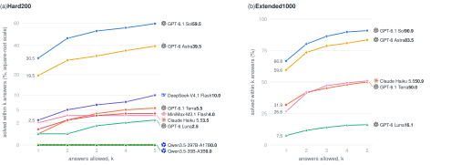
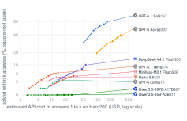
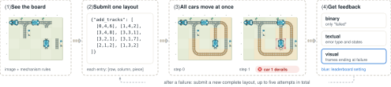
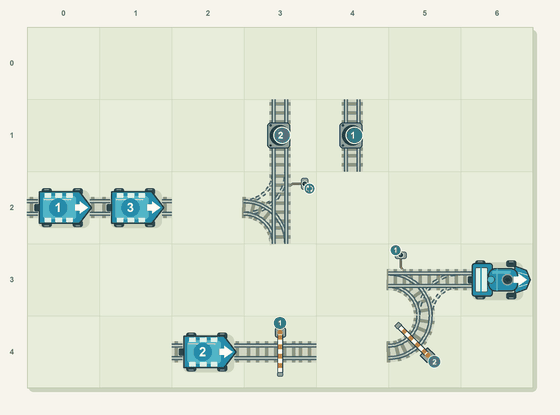
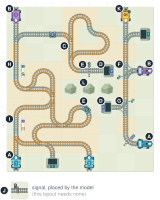
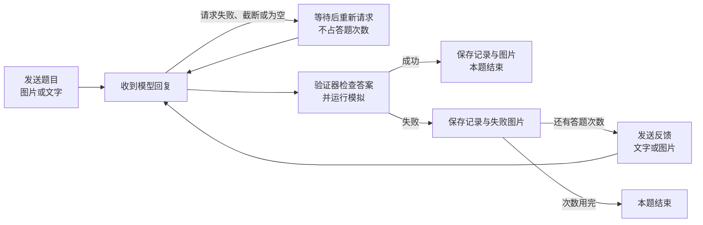

# Railbound-Bench

[English](README.md) | **中文**

Railbound-Bench 是一个评测多模态大模型时空规划与计划修复能力的 benchmark，受到 [Railbound](https://afterburn.games/railbound/) 游戏的启发。本 benchmark 参考了 Railbound 官方的 233 个谜题，制作了 200 个高难度谜题和 1000 个难度各异、与官方关卡分布相似的扩展谜题。每个谜题都有题目的文字和图像形式、参考解答的文字和图像形式。此外，我们还提供验证器（检查答案的程序）、布局求解器（基于规则的谜题求解器）、评测程序及部分辅助程序。模型直接从文本/图像中推断，而无需工具、代理或代码执行。

论文：*Seeing Is Not Planning: Spatiotemporal Planning and Plan Repair in Multimodal LLMs*

---

## 主要结果

下图是 9 个模型的榜单。纵轴是"最多答 k 次以内解出的题目比例"（S@k）：模型第一次答错后，会看到上一次失败的画面，然后重新提交完整答案，最多 5 次。Hard200 是论文的主榜，Extended1000 题目更多、难度跨度更大。

<p align="center"></p>

下图把 Hard200 上每个模型答前 k 次的估算 API 费用与 S@k 画在一起。费用按各平台官方标价和记录的 token 数估算。标签是 k=5 时的总费用。

<p align="center"></p>

## Benchmark 介绍

### 任务

每道题是一个网格棋盘，上面有固定轨道、车厢、车头和各种机关。模型要在空格上补铺轨道（直轨、弯轨或三岔轨），轨道数量不能超过题目给的额度，部分题目还可以放置信号灯。模型一次性返回全部新增轨道，模拟器随后让所有车厢同时出发，判断这个布局能不能把每节车厢按顺序送到车头。失败后，模型会收到反馈并重新提交一个完整布局，最多 5 次（次数可在评测时用 `--rounds` 修改）。



### 游戏规则

棋盘按"步"运行：每一步所有车厢同时向前移动一格，除非被闸门、信号灯或站台拦住。每节车厢要到达同类型的车头，同类型的车厢必须按编号从小到大依次到达，到达后离开棋盘。以下任一情况都算失败：

- 两节车厢进入同一格，或在相邻两格迎面交换位置（碰撞）；
- 车厢开上缺失或接不上的轨道，或开出棋盘（脱轨）；
- 车厢到达顺序错误、进错车头，或漏掉了该停的站台；
- 棋盘回到之前出现过的状态，说明会永远循环下去。

所有需要送达的车厢都按顺序到达车头时，题目成功。由于所有车厢共用轨道和机关，一段轨道能让一节车厢走对，却可能挡住、拖慢或引偏另一节车厢，所以布局只能整体判断。

下面的动图是简单扩展题 E-CT0022 按参考解运行的过程。第一帧是题目本身，之后车厢一步一步前进，橙色轨道是参考解新增的。三节车厢共用中间的道岔和闸门，它们必须先后错开，才能按 1、2、3 的顺序到达车头。

<p align="center"></p>

下图是扩展题 E-TR1501 及其参考解，灰色轨道是题目原有的，橙色轨道是参考解新增的 30 格。字母标出每种元素的一个例子；棋盘上印的数字属于游戏本身，相同数字表示相互关联的对象，例如车厢和它的站台、按钮和它控制的闸门。

<p align="center"></p>

| | 元素 | 规则 |
| --- | --- | --- |
| A | 车厢与车头 | 每节车厢每步沿朝向移动一格，按编号顺序到达车头，送达后离开棋盘 |
| B | 货运车厢 | 货运车厢（罗马数字）去货运车头，按自己的编号顺序到达 |
| C | 三岔轨 | 从弯道任一端进入就沿弯道走，从第三端进入就直行 |
| D | 隧道 | 编号相同的两个洞口相连，从一个进入，同一步从另一个出来 |
| E | 按钮与闸门 | 车厢经过按钮时，同编号的所有闸门切换开关；关闭的闸门前车厢要等待 |
| F | 按钮道岔 | 车厢经过同编号按钮时，这个三岔轨的弯道方向翻转 |
| G | 自动道岔 | 每次有车厢进入，这个三岔轨的弯道方向就翻转 |
| H | 乘客站台 | 编号相同的车厢必须在这里多停两步才能送达，其他车厢直接通过 |
| I | 邮局 | 与站台相同，服务编号相同的货运车厢 |
| J | 信号灯 | 由模型放在三岔轨旁边。拦住车厢，直到另一节车厢驶离那个三岔轨（方向背离信号灯），之后一直保持打开 |
| K | 诱饵车 | 不需要送达，也不能进入车头。它能触发按钮；脱轨后残骸会堵住轨道 |
| L | 石头或建筑 | 不能通行，也不能铺轨 |

### 题库

| 题库 | 位置 | 题数 | 说明 |
| --- | --- | --- | --- |
| Hard200 | `levels/extended-hard/` | 200 | 论文主榜，全部为高难题 |
| Extended1000 | `levels/extended/` | 1000 | 按 easy / medium / hard 分为三档 |
| Controlled180 | `levels/subsets/controlled180.json` | 180 | 从 Extended1000 中选出的固定题目，用于论文中的对照实验 |

每道题的参考解在 `solutions/` 下同名路径，题目图和参考解图与 JSON 放在一起。Controlled180 只是一份题目编号清单，题目本身仍在 `levels/extended/` 中。

## 如何使用

### 1. 安装与模型配置

#### 1.1. 安装环境

需要 Python 3.9 或更高版本。克隆本项目后安装依赖：

```bash
git clone https://github.com/liaoyanqing666/Railbound_Bench.git
cd Railbound_Bench
python -m pip install -r requirements.txt
```

依赖只有三个：`Pillow`（绘图）、`httpx`（请求模型 API）和 `python-dotenv`（读取 `.env`）。求解器可以选装 `g++` 或 `clang++` 来加速，没有编译器时自动使用 Python 版本。

#### 1.2. 配置模型

1. 请编辑 `configs/` 下的配置文件，填写对应的 API 地址（`base_url`）、密钥变量名（`api_key_env`）、模型（`api_model`）和上限（`model_limits`）。
2. 请在项目根目录创建 `.env` 文件，并填写对应的 API 密钥变量，例如 `DEEPSEEK_API=sk-...`。`.env` 已被 Git 忽略。
3. 配置文件由 `benchmark.py` 在启动时读取：它决定请求哪个平台、哪个模型、从哪个环境变量取密钥，以及每次最多生成多少 token 等。配置会完整保存到结果目录的 `run.json` 中，断点续跑时程序会核对配置没有被改动。这样同一份配置可以反复使用，结果也能对应到确切的模型和设置。

以下仅选取部分论文中使用的模型，你也可以自行编辑，或者使用 AI Agents 适配更多的模型、平台或者情况。任何兼容 OpenAI Chat Completions 接口的平台都可以从 `openai_compatible.json` 模板开始。

| 示例配置文件 | 认证与用途 |
| --- | --- |
| `openai_compatible.json` | 任意 Chat Completions 接口的模板：填写地址、密钥变量、模型和官方文档给出的上限 |
| `deepseek.json` | 读取 `DEEPSEEK_API`；DeepSeek API |
| `aliyun_qwen35_35b_a3b.json` | 读取 `ALIYUN_API`；通过阿里云百炼的 OpenAI 兼容接口调用 Qwen3.5-35B-A3B |
| `claude_haiku_api.json` | 读取 `CLAUDE_API`；通过 Anthropic 原生 Messages API 调用 Claude Haiku 5.5 |

你甚至可以不用 API 密钥来测试 GPT 模型：ChatGPT 账号可以通过 OAuth 登录（Codex 使用的就是这种方式）取得访问令牌，再用这个令牌直接调用 OpenAI 的 Responses 接口，用量计入账号的订阅额度。如有需要，可以参考 OpenAI 的官方文档自行适配。

注：使用 Anthropic API 时，可以在配置中设置 `max_text_continuations`（续写次数）。某次生成停在输出上限时，程序把已生成的内容发回，让模型在新一次生成中接着写完同一个答案，而不是直接作废。示例配置设为 2，其他平台不支持这个字段。

### 2. 评测

如需评测某模型，仅需运行以下代码：

```bash
python benchmark.py --config configs/deepseek.json
```

| 参数 | 是否必须 | 默认值 | 含义 |
| --- | --- | --- | --- |
| `--config` | 是 | `configs/deepseek.json` | 模型配置文件 |
| `--levels` | 否 | `levels/extended-hard` | 题库目录或单个关卡文件。默认是论文主榜 Hard200，扩展题库用 `levels/extended` |
| `--level-id` | 否 | 全部 | 只评测指定关卡，可重复使用，例如 `--level-id EH-0001 --level-id EH-0002` |
| `--limit` | 否 | 不限制 | 只评测排序后的前若干关 |
| `--rounds` | 否 | 5 | 每道题最多答几次（包含第一次） |
| `--prompt-mode` | 否 | `image_rules` | 首轮输入形式：<br>`image_rules`：棋盘图片，加上目标、图形含义、输出格式，以及本关机制的规则和时序；<br>`image_no_rules`：同样的图片、目标、图形含义和输出格式，但不说明机关如何变化、要等多久；<br>`text_rules`：不给图片，改为一张文字轨道表、机关和车辆列表、方向通行表，以及本关规则 |
| `--feedback` | 否 | 随输入形式 | 答错后的反馈：<br>`binary`：只告诉模型失败了；<br>`textual`：用文字描述错误类型和所选时刻的轨道、机关、车辆状态；<br>`visual`：把同样的时刻画成图片发给模型。<br>图片输入默认 `visual`，文字输入默认 `textual` |
| `--history-steps` | 否 | 1 | 反馈中包含几个时刻的状态，0 表示全部 |
| `--history-gap` | 否 | 1 | 反馈中相邻两个时刻之间隔几步 |
| `--workers` | 否 | 16 | 同时评测的关卡数，也就是最多同时发出的模型请求数 |
| `--output` | 否 | `output` | 结果保存目录 |

<details>
<summary>其他工程参数</summary>

| 参数 | 是否必须 | 默认值 | 含义 |
| --- | --- | --- | --- |
| `--max-retry` / `--max_retry` | 否 | 2 | 请求失败后，转为延迟重试前的短重试次数 |
| `--retry-delay` | 否 | 60 | 短重试用尽后，第一次等待的秒数 |
| `--retry-max-delay` | 否 | 600 | 延迟重试的最长等待秒数，到达后仍继续重试 |
| `--max-ticks` | 否 | 10000 | 每次模拟最多运行的步数，通常不修改 |
| `--resume` | 否 | 无 | 从已有结果目录继续运行，其余参数须与原来一致 |
| `--resolve-model` | 否 | 关闭 | 只读取模型的输出上限和上下文长度，不发起评测 |

</details>

几点补充：

- 模型每次都要给出相对原题的**完整**新增轨道列表，而不是在上一次答案上修改。格式为 `{"add_tracks":[[行,列,轨道编码], ...],"add_semaphores":[[行,列], ...]}`，坐标从 0 开始；只有题目允许新增信号灯时才需要 `add_semaphores`。
- 只有格式正确、能被判定的答案才占用一次答题机会。网络错误、超时、被截断或内容为空的回复会在同一轮重新请求，不算模型答错。
- 运行中断后，用原来的配置和参数加上 `--resume` 可以接着跑，已完成的关卡不会重复请求，例如 `python benchmark.py --config configs/deepseek.json --resume output/结果目录`。

**运行流程**：每道题按下面的顺序循环，直到解出或用完答题次数。



### 3. 查看运行结果

评测过程中，终端会逐题打印每关的状态（`success` 表示解出，`exhausted` 表示用完次数仍未解出）。全部结束后，运行下面的命令查看成绩：

```bash
python benchmark.py --summarize output/结果目录
```

输出中最常用的几项：

| 字段 | 含义 |
| --- | --- |
| `campaign_accuracy` | 总正确率，即 S@5（`--rounds` 为 5 时）。还有关卡没跑完时为 `null` |
| `success_by_round` | 第 k 次答对的题数；把第 1 到 k 次相加再除以总题数就是 S@k |
| `error_types` | 所有错误答案的错误类型统计，如 `derailment`（脱轨）、`collision`（碰撞）、`wrong_order`（顺序错误）、`illegal_edit`（改动了原有内容） |
| `final_error_types` | 未解出的题最后一次答案的错误类型 |
| `request_error_types` | 网络、超时等请求错误，不计入模型成绩 |

结果目录 `output/模型名_时间戳/` 中包含：

- `run.json`：模型配置、评测参数、题目内容和汇总；
- `关卡名.json`：每关每次回答的原文、判定结果和错误类型；
- `images/`：每次答案的布局图（`-answer.png`），答错时另有失败图（`-failure.png`），标出碰撞或脱轨位置。

如果更新了验证器，可以用 `--rejudge-results output/结果目录` 按新规则重新判定已保存的回答；`--render-results` 只重新绘图。两者都不会请求模型。

## 文件说明

* `assets/`：README 中使用的图片。

* `configs/`：模型配置文件，每个文件对应一个模型和一组请求设置。

* `levels/`：全部题目。`extended-hard/` 为 Hard200，`extended/` 为 Extended1000（分 `easy/`、`medium/`、`hard/`），`subsets/controlled180.json` 是论文对照实验使用的 180 道固定扩展题。每个题库带一个 `manifest.json` 题目清单，每道题有 JSON 和 PNG 图片。

* `make_images/`：绘图程序，把题目、参考解或模拟中任一时刻画成图片。`style.json` 保存颜色和尺寸设置。

* `models/`：模型请求代码。`providers.py` 读取配置并发送 OpenAI 兼容格式的请求；`anthropic_api.py` 调用 Anthropic 原生接口；`capabilities.py` 获取所选模型的最大输出长度和上下文长度。

* `solutions/`：参考解，目录结构与 `levels/` 一一对应，每道题有新增轨道 JSON 和完成后的图片。

* `solver/`：布局求解器，用来寻找可行解和最少轨道数，并衡量题目难度。详见[求解器文档](solver/README.md)。

* `validator/`：验证器。检查答案格式和是否违规，把新增轨道合成完整棋盘，再逐步模拟所有车厢，返回成功与否、错误类型和运行过程。

* `benchmark.py`：评测主程序，负责发送题目、判定答案、发送反馈、失败重试、断点续跑和汇总成绩。

* `prompts.py`：发给模型的英文提示词，包括首轮题目说明和每种反馈的文字。

* `requirements.txt`：Python 依赖列表。

## 技术细节

一般使用不需要阅读本节。这里用例子说明代码中几个主要部分是怎样工作的。

1. **题目格式**：每道题是一个 JSON，`board` 是轨道和障碍物的编码矩阵，`mods` 标出按钮、闸门、站台等机关，`mod_nums` 给出机关的编号，`cars` 列出车厢的位置、朝向、编号和类型，`tracks` 和 `semaphores` 是可新增轨道和信号灯的额度。一个最小的例子：

   ```json
   {"schema_version": 1, "level_id": "1-1", "board": [[1, 0, 0, 0, 3]], "mods": [[10, 0, 0, 0, 0]], "mod_nums": [[0, 0, 0, 0, 0]],
    "cars": [{"pos": [0, 0], "direction": "RIGHT", "num": 0, "type": "NORMAL"}], "tracks": 3, "semaphores": 0}
   ```

   这是一行 5 格的棋盘：最左边是一段直轨，上面停着 0 号客车，最右边（编码 3）是朝右的车头，中间三格是空的。它的参考解是 `{"add_tracks":[[0,1,1],[0,2,1],[0,3,1]]}`，即在三个空格各铺一段水平直轨（编码 1）。坐标是从 0 开始的 `[行,列]`。全部编码见下表。

   <details>
   <summary>棋盘与机关编码</summary>

   | `board` 编码 | 含义 |
   | --- | --- |
   | 0；1、2；3；4 | 空格；水平/竖直直轨；朝右的客运车头；石头 |
   | 5、6、7、8 | 弯轨：下–右、下–左、上–右、上–左 |
   | 9、10 | 优先弯道为下–右的三岔轨，额外分支分别在左、上 |
   | 11、12 | 优先弯道为下–左的三岔轨，额外分支分别在右、上 |
   | 13、14 | 优先弯道为上–右的三岔轨，额外分支分别在左、下 |
   | 15、16 | 优先弯道为上–左的三岔轨，额外分支分别在右、下 |
   | 17、18、19、20 | 洞口朝左、右、下、上的隧道 |
   | 21、22 | 朝右、朝左的货运车头 |
   | 29、30、31 | 朝左、朝下、朝上的客运车头 |
   | 32、33 | 朝下、朝上的货运车头 |
   | 34、35、36、37 | 朝左、右、下、上的站房（不能通行） |

   | `mods` 编码 | 含义（`mod_nums` 的含义） |
   | --- | --- |
   | 0 | 无 |
   | 1 | 按钮（所属组编号） |
   | 2 | 隧道（配对洞口编号） |
   | 3、4 | 关闭/打开的闸门（所属组编号） |
   | 5 | 按钮道岔（所属组编号） |
   | 6 | 乘客站台（服务的客车编号） |
   | 7 | 自动道岔 |
   | 8 | 关闭的信号灯 |
   | 10 | 车厢起点 |
   | 11 | 邮局（服务的货车编号） |

   车厢类型 `NORMAL`、`NUMERAL`、`DECOY` 分别是客车、货车和诱饵车，每类从 0 开始编号；图上的客车编号从 1 开始，货车用罗马数字。

   </details>

2. **答案检查**：`validator.validate(level, answer)` 先检查答案是不是合法 JSON、字段是否正确，再检查有没有改动原有的轨道、机关或车厢，新增轨道是否只铺在空格、是否超出额度。全部通过后，把新增轨道和原题合成完整棋盘交给模拟器。原有的轨道即使编码不变，也不能再次列入新增列表。

   ```python
   from validator import validate
   result = validate(level, '{"add_tracks":[[0,1,1],[0,2,1],[0,3,1]]}')
   print(result['success'], result['error_type'], result['message'])
   ```

   返回结果包含 `success`、`error_type`、`message`、出错位置 `error_positions`、完整运行过程 `trace`，以及供反馈使用的部分时刻 `feedback_states`。命令行版本：`python -m validator 题目.json 答案.json`。

3. **模拟器**：每一步，所有车厢同时决定下一格。程序先算出每节车厢要去哪里，再统一检查碰撞、脱轨和到达；跟在正常行驶的前车后面进入它刚离开的格子是允许的。按钮、闸门、道岔在本步移动结束后才改变状态，所以同一步里车厢看到的是同一个棋盘。程序还会记录每一步的完整状态（轨道、机关、车厢、等待计数等），一旦出现重复状态就判定为循环；超过 `--max-ticks` 步时返回 `resource_limit`。

4. **反馈怎么选时刻**：模拟从第 0 步一直记录到出错的那一步。`--history-steps` 和 `--history-gap` 从出错时刻往回取样。例如 `--history-steps 3 --history-gap 2`，出错在第 9 步，就取第 5、7、9 步三个时刻，按时间顺序发给模型。文字反馈只描述画面上能看到的东西（轨道、机关状态、车厢位置和朝向、碰撞位置），不透露模拟器内部的计时器和事件队列。轨道或信号灯超出额度时，只用文字说明额度和实际用量，不发送图片。

5. **绘图**：`make_images` 可以画题目、参考解或模拟中的任一时刻。原有轨道为钢灰色，新增轨道为琥珀色，车头的尖端和白色箭头表示行驶方向。失败图用半透明车影表示上一步的位置，用箭头表示最后一次移动，用白橙色爆炸标出碰撞。

   ```bash
   python -m make_images levels/extended-hard --recursive
   python -m make_images solutions/extended-hard --recursive --levels-root levels/extended-hard
   ```

6. **求解器**：`solver/` 不调用任何模型。它运行模拟器，每当车厢即将开进一个空格时，就分别尝试在这里放各种轨道；一旦某个分支出错、额度用完或车厢已经不可能到达，就放弃这个分支。默认寻找最少轨道数的解，`--feasible` 只要求在额度内找到一个解。

   ```bash
   python -m solver levels/extended-hard/hard/EH-0001.json --feasible --timeout 600
   ```

   结果为 `OPTIMAL`（找到解并证明不能更省轨道）、`SAT`（找到并验证了解，但未证明最省）、`UNSAT`（证明在额度内无解）或 `UNKNOWN`（时间或搜索量用完，还不能下结论）。不给参考解时，求解器找到第一个解前尝试的次数（搜索节点数）就是题目的难度标签：不超过 1,000 为 easy，1,001–100,000 为 medium，超过 100,000 为 hard。

7. **请求与重试**：请求失败时先分别间隔 1 秒和 2 秒快速重试两次，再依次等待 1、2、4、8 分钟，之后每 10 分钟重试一次，直到收到回复。密钥错误等需要人工处理的问题会把关卡标记为 `needs_attention`，修正后用 `--resume` 继续。模型的推理内容不会被当作答案；只有最终回复正文会被判定。

8. **结果记录与续跑**：每次收到回复或得到判定，程序都会立即写入关卡 JSON，因此任何时候中断都不会丢失已有回答。续跑时，程序先核对配置、参数和题目内容与原来完全一致，再根据保存的回答重建对话，从中断的地方继续。

## 引用与联系

如果本项目对你有帮助，欢迎引用我们的论文：

```bibtex
（引用信息待补充）
```

如有代码问题，欢迎提交 [Issue](https://github.com/liaoyanqing666/Railbound_Bench/issues)，或者联系作者（[个人网站](https://siyuanli.tech/) / [GitHub](https://github.com/liaoyanqing666)）。
